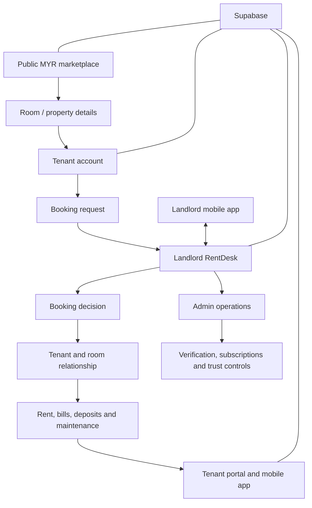
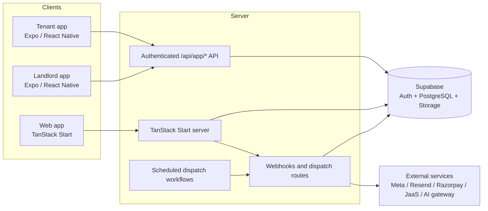

<div align="center">

# Rentalos

### A connected rental ecosystem for tenants, landlords, and property operators.

**Discover rental spaces. Manage properties. Handle rent, bills, tenants, and day-to-day operations in one connected platform.**

[](https://www.rentalos.in)
[](https://react.dev/)
[](https://www.typescriptlang.org/)
[](https://supabase.com/)

[Website](https://www.rentalos.in) · [Explore Rooms](https://www.rentalos.in/myr/browse) · [About](https://www.rentalos.in/about) · [Contact](https://www.rentalos.in/contact)

</div>

---

## Table of contents

- [Overview](#overview)
- [The Rentalos ecosystem](#the-rentalos-ecosystem)
- [Product capabilities](#product-capabilities)
- [Application architecture](#application-architecture)
- [Technology stack](#technology-stack)
- [Repository structure](#repository-structure)
- [Getting started](#getting-started)
- [Environment configuration](#environment-configuration)
- [Database and migrations](#database-and-migrations)
- [Running the mobile applications](#running-the-mobile-applications)
- [Deployment](#deployment)
- [Background jobs and integrations](#background-jobs-and-integrations)
- [Testing and code quality](#testing-and-code-quality)
- [Security notes](#security-notes)
- [Current implementation notes](#current-implementation-notes)
- [Contributing](#contributing)
- [License](#license)

## Overview

Rentalos is a rental-property platform built to connect the rental discovery experience with the operational work that happens after a tenant finds a place.

Most rental workflows are fragmented: discovery happens in one place, tenant records in another, rent and utility calculations in spreadsheets, and communication across calls or messaging apps. Rentalos brings these workflows into a connected product.

The repository contains:

1. **MYR** — the public room and property discovery experience for tenants.
2. **RentDesk** — the landlord-facing property and rental operations workspace.
3. **Tenant experience** — tenant account, booking, rent, bills, documents, maintenance, and communication workflows.
4. **Mobile applications** — separate Expo / React Native applications for tenant and landlord use.
5. **Admin tools** — internal operations for verification, subscriptions, moderation, partner organisations, security, and support.

The web application and mobile applications use the same Supabase-backed platform. The mobile apps call authenticated server endpoints exposed by the web application.

> **Product principle:** rental operations should be understandable and manageable for everyday landlords, while tenants should have a clear view of their stay, payments, documents, and requests.

## The Rentalos ecosystem



### Main product surfaces

| Surface | Primary audience | Purpose |
|---|---|---|
| MYR marketplace | Prospective tenants | Browse rooms and properties, view listing details, save options, contact or request a booking |
| RentDesk web | Landlords / property operators | Manage properties, rooms, tenants, rent, bills, deposits, meter readings, maintenance and rental terms |
| Tenant portal | Existing tenants | Access stay details, rent and bill history, payments, documents, meter readings, maintenance and notifications |
| Tenant mobile app | Tenants | Mobile access to discovery, bookings, roommates, inbox, documents and stay-related workflows |
| Landlord mobile app | Landlords | Mobile access to properties, rooms, requests, tenants, bills, payments, meter readings and reports |
| Admin console | Platform administrators | Review users, identity and listing verification, subscriptions, partner organisations, audits, fraud and operational issues |

## Product capabilities

The following capabilities are represented in the source code. Availability in a deployed environment can depend on database migrations, environment variables, subscription entitlements, third-party configuration, and platform permissions.

### 1. MYR — rental discovery

- Public room and property browsing.
- City-based discovery and city landing pages.
- Room and listing detail pages.
- Listing photos and live-feed media support.
- Saved listings and tenant profiles.
- Roommate discovery, profiles, chat, and video-call support.
- Tenant booking requests and landlord-facing inquiry workflows.
- Listing and identity verification workflows.
- Public listing and SEO metadata helpers, canonical URLs, structured data, and a dynamic sitemap.

### 2. RentDesk — landlord operations

- Property and room management.
- Room availability and occupancy lifecycle.
- Listing readiness checks before publication.
- Tenant records, room assignment, and tenant verification workflows.
- Booking request review and acceptance / rejection.
- Rent bills, bill history, payment status, receipts, and PDF generation.
- Payment-proof review and verification.
- Security-deposit creation, settlement, deductions, and history.
- Electricity meter readings, tenant meter submissions, validation, and analysis.
- Meter-photo OCR assistance where the AI gateway is configured.
- Maintenance requests, priorities, status updates, and resolution notes.
- Move-in and move-out records and related financial checks.
- Landlord expenses and operational reports.
- Rental terms, version history, and tenant acknowledgement / re-acceptance.
- Parking details, including dedicated, shared, nearby, street, paid, and other supported parking information.
- Notifications and account settings.
- Subscription plans and feature entitlements.
- Partner organisation CSV import for supported partner accounts.

### 3. Tenant experience

- Tenant account and profile.
- Room / stay details.
- Booking and request status.
- Rent and bill history.
- Online payment flow where the payment gateway is configured.
- Payment proof and payment-status visibility.
- Deposit information.
- Meter-reading submission.
- Maintenance requests.
- Tenant documents.
- Notifications and notification preferences.
- Roommate discovery and communication features.

### 4. Admin and platform operations

The admin routes include tools for:

- User and administrator management.
- Booking oversight.
- Identity and property verification.
- MYR verification review.
- Subscription and entitlement administration.
- Partner organisation creation and account linking.
- Feedback management.
- Fraud and security review.
- Audit logs and operational activity.
- Diagnostics and operational monitoring.
- Rental-term administration.
- Live-feed review.
- WhatsApp automation administration.

Admin routes are internal application surfaces and should only be accessible to authorised administrators.

### 5. Messaging and automation

The repository includes an integration with the **official Meta WhatsApp Cloud API**:

- Webhook verification and inbound message handling.
- Template-message dispatch.
- Notification dispatch with retry-aware outcomes.
- Server-side credentials; access tokens are not intended for client bundles.
- Simulated / mock mode when required Meta credentials are absent.

The codebase also contains email functionality through Resend and some legacy integration references. Configure only the providers actually used by the deployment. A successful local or mock response does not mean a real message was delivered.

## Application architecture



### Web application

- React 19 and TypeScript.
- TanStack Start for file-based routing and server-side application functionality.
- TanStack Router and TanStack Query.
- Vite for development and builds.
- Tailwind CSS 4 and Radix-based UI components.
- React Hook Form and Zod for form handling and validation.
- Recharts for data visualisation.
- Framer Motion for interface animation.

### Backend and data

- Supabase Authentication.
- Supabase PostgreSQL.
- Supabase Storage for supported uploads and media.
- Supabase JavaScript client.
- Server-side functions for privileged workflows.
- SQL migrations for schema, functions, policies, and supporting database logic.

### Mobile applications

The repository contains two independent Expo applications:

- `mobile/` — tenant-facing application.
- `landlord/` — landlord-facing RentDesk application.

Both use Expo Router, React Native, TypeScript, Supabase authentication, and the Rentalos server's `/api/app/*` endpoints.

### Important server endpoints

The custom server entry (`src/server.ts`) explicitly handles these routes:

| Endpoint | Method | Purpose |
|---|---|---|
| `/api/health` | GET | Application and database liveness check |
| `/sitemap.xml` | GET | Dynamic sitemap |
| `/api/app/*` | POST | Authenticated mobile API |
| `/api/whatsapp/webhook` | GET / POST | Meta webhook verification and inbound events |
| `/api/whatsapp/dispatch` | POST | Protected pending WhatsApp dispatch |
| `/api/razorpay/webhook` | Provider callback | Razorpay webhook handling |

Other application workflows are implemented through TanStack Start routes and server functions.

## Technology stack

| Area | Technologies |
|---|---|
| Language | TypeScript |
| Web UI | React 19 |
| Web framework | TanStack Start |
| Routing | TanStack Router |
| Data fetching | TanStack Query |
| Build tooling | Vite 7 |
| Styling | Tailwind CSS 4 |
| UI primitives | Radix UI, Lucide React |
| Forms and validation | React Hook Form, Zod |
| Charts | Recharts |
| Animation | Framer Motion |
| Backend | Supabase |
| Database | PostgreSQL |
| Authentication | Supabase Auth |
| Mobile | Expo SDK 57, React Native 0.86, Expo Router |
| Testing | Vitest |
| Linting | ESLint |
| Formatting | Prettier |
| Deployment configuration | Vercel and Cloudflare-oriented Vite configuration |
| Messaging | Meta WhatsApp Cloud API |
| Email | Resend integration |
| Payments | Razorpay integration |
| Video calling | JaaS integration |

## Repository structure

```text
Rentalos/
├── .github/
│   ├── scripts/                  # Scheduled dispatch helper scripts
│   └── workflows/                # CI, WhatsApp and push dispatch workflows
│
├── landlord/                     # Landlord RentDesk mobile app (Expo)
│   ├── app/                      # Screens and tab routes
│   └── src/                      # API, auth, UI and shared mobile logic
│
├── mobile/                       # Tenant mobile app (Expo)
│   ├── app/                      # Tenant screens and tab routes
│   └── src/                      # API, auth, i18n, UI and shared logic
│
├── src/
│   ├── components/               # Shared web UI and application components
│   ├── integrations/
│   │   └── supabase/             # Supabase clients and auth middleware
│   ├── lib/                      # Domain logic, server functions and services
│   │   ├── whatsapp/             # Meta WhatsApp integration
│   │   ├── subscription/         # Subscription entitlements and plan keys
│   │   └── _tests_/              # Automated tests
│   ├── routes/
│   │   ├── _authenticated/       # Authenticated landlord workflows
│   │   ├── admin/                # Admin console
│   │   ├── myr/                  # Public marketplace and tenant discovery
│   │   └── tenant/               # Tenant portal
│   └── server.ts                 # Custom server entry and API handlers
│
├── supabase/
│   └── migrations/               # Ordered SQL database migrations
│
├── package.json
├── package-lock.json
├── vite.config.ts
├── vite.config.vercel.ts
├── vercel.json
├── wrangler.jsonc
└── README.md
```

## Getting started

### Prerequisites

Install the following before running the web application:

- Node.js 22 (recommended; the repository CI workflow uses Node.js 22).
- npm.
- A Supabase project.
- Git.

For mobile development, also install Expo Go on a compatible phone or configure an Android emulator.

### 1. Clone the repository

```bash
git clone https://github.com/arpitilu59-star/Rentalos.git
cd Rentalos
```

### 2. Install dependencies

```bash
npm install
```

Use `npm install` rather than assuming `npm ci` is interchangeable: the repository's CI workflow currently uses `npm install` because its lockfile has previously been noted as out of sync with `package.json`.

### 3. Configure environment variables

Create a root `.env` file and add the required values for your environment. See [Environment configuration](#environment-configuration).

Do not commit `.env` files or expose server secrets in variables prefixed with `VITE_` or `EXPO_PUBLIC_`.

### 4. Configure Supabase

- Create or select a Supabase project.
- Configure the project URL and publishable / anon key.
- Apply the SQL migrations in `supabase/migrations/` in chronological order to a fresh database, or reconcile them carefully with an existing database.
- Configure the required Storage buckets and access policies for the features you enable.
- Configure Authentication redirect URLs for your local and deployed domains.

See [Database and migrations](#database-and-migrations).

### 5. Start the web application

```bash
npm run dev
```

Vite prints the local development URL in the terminal. Open that URL in your browser.

### 6. Production build and preview

```bash
npm run build
npm run preview
```

The `build` script uses the repository's default Vite configuration. For the Vercel-specific build configuration, see [Deployment](#deployment).

## Environment configuration

There is no root `.env.example` in the supplied repository snapshot. The variables below are based on environment-variable references found in the source code. Add only the variables needed by the features and deployment target you use.

### Web application and server

| Variable | Scope | Purpose |
|---|---|---|
| `VITE_SUPABASE_URL` | Browser | Supabase project URL |
| `VITE_SUPABASE_PUBLISHABLE_KEY` | Browser | Supabase publishable / anon key |
| `SUPABASE_URL` | Server | Supabase project URL |
| `SUPABASE_PUBLISHABLE_KEY` | Server | Supabase publishable / anon key |
| `SUPABASE_SERVICE_ROLE_KEY` | Server secret | Privileged server-side Supabase operations; never expose to the browser |
| `VITE_SITE_URL` | Build / public config | Overrides the canonical website URL used by SEO helpers |

### Optional server integrations

| Variable | Used for |
|---|---|
| `RESEND_API_KEY` | Email functionality |
| `LOVABLE_API_KEY` | Lovable AI Gateway features, including meter OCR assistance and selected AI-backed workflows |
| `RAZORPAY_KEY_ID` | Razorpay checkout / order integration |
| `RAZORPAY_KEY_SECRET` | Server-side Razorpay signing and API authentication |
| `RAZORPAY_WEBHOOK_SECRET` | Razorpay webhook signature verification |
| `META_WHATSAPP_ACCESS_TOKEN` | Meta WhatsApp Cloud API access |
| `META_WHATSAPP_PHONE_NUMBER_ID` | Meta WhatsApp sender phone-number ID |
| `META_WHATSAPP_VERIFY_TOKEN` | Meta webhook verification token |
| `META_APP_SECRET` | Meta webhook signature validation |
| `META_GRAPH_API_VERSION` | Optional Graph API version override |
| `WHATSAPP_DISPATCH_SECRET` | Protects the WhatsApp dispatch endpoint |
| `META_TEMPLATE_RENT_OVERDUE` | Template identifier used by the relevant WhatsApp workflow |
| `PUSH_DISPATCH_SECRET` | Protects scheduled mobile push dispatch |
| `JAAS_APP_ID` | JaaS video-call application ID |
| `JAAS_KEY_ID` | JaaS signing key ID |
| `JAAS_PRIVATE_KEY` | JaaS server-side private key |
| `VIDEO_DOMAIN` | Optional video service domain configuration |
| `SITE_URL` | Website URL used by selected server-side messaging workflows |

Some files still contain references to older or alternate provider integrations. Verify the active code path before configuring a provider; the presence of a variable reference does not mean every workflow requires it.

### Mobile application variables

Both Expo apps read these public variables:

| Variable | Purpose |
|---|---|
| `EXPO_PUBLIC_SUPABASE_URL` | Supabase project URL |
| `EXPO_PUBLIC_SUPABASE_ANON_KEY` | Supabase publishable / anon key |
| `EXPO_PUBLIC_API_URL` | Base URL of the Rentalos web backend; defaults to `https://www.rentalos.in` in the app code |

Create a `.env` file inside the relevant app directory (`mobile/` or `landlord/`) before running it. Do not put service-role keys or other privileged secrets in an Expo environment file.

## Database and migrations

Database changes are maintained as SQL migrations in:

```text
supabase/migrations/
```

The migration history includes changes for areas such as:

- Core rental and property workflows.
- Roommate matching and chat.
- Trust and verification.
- Partner organisations and bulk import.
- Automation and rent workflows.
- Parking information and lease expiry.
- WhatsApp integration.
- Subscription plans and entitlements.
- Rental terms and tenant re-acceptance.
- Room availability lifecycle.
- Gateway payments.
- Live photos and room profiles.
- Mobile push notifications.
- Tenant documents and meter workflows.
- Notification preferences.
- RentDesk gender compatibility and meter GPS.
- Expenses and product feedback.

### Applying migrations

For a new Supabase environment:

1. Back up or create the target project.
2. Review the migration files and their dependencies.
3. Apply every required migration in timestamp order.
4. Confirm that database functions, triggers, RLS policies, and Storage buckets are present.
5. Configure Auth redirect URLs and provider settings.
6. Test the main user flows with separate landlord, tenant, and admin accounts.

For an existing production database, do **not** blindly replay all SQL files. Compare the applied migration history first and take a database backup before making schema changes.

The application uses privileged server-side operations for selected workflows. Keep the service-role key exclusively on the server and review RLS policies whenever adding a new table or storage path.

## Running the mobile applications

The tenant and landlord apps are separate Expo projects. Run commands from each app's directory.

### Tenant app

```bash
cd mobile
npm install --legacy-peer-deps
```

Create `mobile/.env`:

```dotenv
EXPO_PUBLIC_SUPABASE_URL=https://YOUR_PROJECT.supabase.co
EXPO_PUBLIC_SUPABASE_ANON_KEY=YOUR_SUPABASE_PUBLISHABLE_OR_ANON_KEY
EXPO_PUBLIC_API_URL=https://www.rentalos.in
```

Start Expo:

```bash
npx expo start
```

Use Expo Go to scan the QR code, or start an Android emulator and run:

```bash
npx expo start --android
```

### Landlord / RentDesk app

```bash
cd landlord
npm install
```

Create `landlord/.env`:

```dotenv
EXPO_PUBLIC_SUPABASE_URL=https://YOUR_PROJECT.supabase.co
EXPO_PUBLIC_SUPABASE_ANON_KEY=YOUR_SUPABASE_PUBLISHABLE_OR_ANON_KEY
EXPO_PUBLIC_API_URL=https://www.rentalos.in
```

Start Expo:

```bash
npx expo start
```

For Android:

```bash
npx expo start --android
```

### Mobile backend dependency

Both mobile applications call the deployed Rentalos backend through `/api/app/*`. The backend and its required Supabase migrations must be deployed before all mobile features can work.

The repository includes mobile feature-parity notes in `landlord/FEATURE_PARITY.md`. That document distinguishes implemented, partial, and platform- or configuration-blocked landlord-app capabilities. Physical-device testing is still necessary for camera, GPS, notifications, and other device-specific functionality.

### Android production builds

The apps include Expo Application Services configuration. A typical EAS build workflow is:

```bash
npm install -g eas-cli
eas login
eas build:configure
eas build -p android --profile production
```

Run these commands from the relevant mobile app directory and review its `eas.json` before producing a release build.

## Deployment

### Vercel

The repository includes:

- `vercel.json`
- `vite.config.vercel.ts`

The Vercel configuration specifies:

```json
{
  "buildCommand": "vite build --config vite.config.vercel.ts",
  "outputDirectory": ".output/public",
  "installCommand": "npm install"
}
```

Deployment outline:

1. Import the GitHub repository into Vercel.
2. Configure the project environment variables.
3. Use the build and output settings defined in `vercel.json`.
4. Deploy.
5. Add the production domain in Vercel.
6. Configure Supabase Authentication Site URL and Redirect URLs to match the deployed domain.
7. Verify `/api/health`, authentication, database access, uploads, and any configured integrations.

The repository's default `vite.config.ts` and `vite.config.vercel.ts` are intentionally separate. The former uses the Lovable TanStack configuration, while the latter sets the TanStack Start target to Vercel. Do not casually replace one with the other without checking the deployment target.

### Cloudflare / Lovable-oriented setup

The default Vite configuration imports `@lovable.dev/vite-tanstack-config`, and the repository also includes `wrangler.jsonc` and the Cloudflare Vite plugin dependency. Review the deployment target and the current hosting configuration before deploying. A build that works for one target is not proof that the other target is configured correctly.

### Domain and authentication

After connecting a custom domain:

- Set the Supabase Auth Site URL to the canonical production URL.
- Add the required local, preview, and production redirect URLs.
- Check OAuth callback URLs if OAuth providers are enabled.
- Confirm canonical URL and sitemap output for the production domain.

## Background jobs and integrations

### WhatsApp dispatch

The repository includes `.github/workflows/whatsapp-dispatch.yml`, which is scheduled every 10 minutes and can also be triggered manually from GitHub Actions.

Configure the repository secret:

```text
WHATSAPP_DISPATCH_SECRET
```

The workflow calls the production dispatch endpoint. The matching server environment variable must contain the same secret. The workflow also supports a repository variable for overriding the dispatch URL.

Meta Cloud API setup requires:

1. A Meta developer app with WhatsApp configured.
2. A WhatsApp Business phone number and approved message templates as required by the workflows.
3. Server-side access token, phone-number ID, webhook verify token, and app secret.
4. The webhook URL configured in Meta:

   ```text
   https://www.rentalos.in/api/whatsapp/webhook
   ```

5. The `messages` webhook subscription.
6. A matching dispatch secret in the hosting environment and GitHub repository secrets.

If Meta credentials are missing, the client can return a simulated result. Confirm actual delivery from Meta responses and logs rather than treating mock mode as successful delivery.

### Mobile push dispatch

The repository includes `.github/workflows/push-dispatch.yml`, scheduled every 5 minutes. It calls:

```text
POST https://www.rentalos.in/api/app/push/dispatch
```

Configure `PUSH_DISPATCH_SECRET` in the server environment and the corresponding GitHub Actions secret (`PUSH_DISPATCH_SECRET`, or the documented fallback secret). Push delivery also depends on the relevant database migration and Expo / FCM / EAS configuration.

### Other integrations

- **Resend:** email workflows require `RESEND_API_KEY`.
- **Razorpay:** payment order creation and webhook verification require the relevant Razorpay keys and webhook configuration.
- **JaaS:** video-call token generation requires server-side JaaS credentials.
- **AI gateway:** OCR and selected AI-assisted functionality require a compatible configured gateway key.

These services are optional at the platform level but required for the specific features that depend on them.

## Testing and code quality

### Web tests

```bash
npm test
```

This runs Vitest using the repository's configured test script.

### Lint

```bash
npm run lint
```

### Format

```bash
npm run format
```

### Production build

```bash
npm run build
```

The GitHub Actions CI workflow uses Node.js 22, installs dependencies, installs FFmpeg for a video-related test, runs Vitest (excluding the mobile internationalisation test in that workflow), and builds the web application.

### Mobile type checks

Run from the relevant app directory:

```bash
npm run typecheck
```

Also test on physical devices for camera capture, GPS validation, video, notifications, file uploads, and deep links. Emulator or Expo Go success does not guarantee production-device behaviour.

## Security notes

- Never commit `.env`, service-role keys, private keys, API tokens, webhook secrets, or production credentials.
- `SUPABASE_SERVICE_ROLE_KEY`, Razorpay secrets, Meta access tokens, JaaS private keys, and dispatch secrets must remain server-side.
- Expo `EXPO_PUBLIC_*` values are bundled into the app and must be treated as public.
- Validate authentication and authorisation on the server; hiding a UI control is not an access-control boundary.
- Review Supabase Row Level Security policies and Storage policies for every new data type.
- Keep webhook signature verification and dispatch-secret checks enabled.
- Use HTTPS for production APIs and webhook endpoints.
- Do not store real tenant identity documents or payment proofs in public storage buckets.
- Back up the database before applying production migrations.

## Current implementation notes

This README describes the repository snapshot from which it was generated. A few important distinctions:

- Feature code may exist while the corresponding external service, migration, secret, or mobile build configuration is not yet enabled.
- The landlord app's `FEATURE_PARITY.md` is the detailed source for its documented feature status and limitations.
- The repository includes both a tenant mobile app and a landlord mobile app; they are independent Expo projects.
- The root repository snapshot does not include a root `.env.example`. Use the variable reference above to create a local environment file and keep it out of version control.
- Some older documentation files describe earlier deployment or payment approaches. Prefer the current source code, migration history, and deployment configuration when resolving conflicts.
- This project is actively evolving. Re-check routes, migrations, environment variables, and integration configuration before publishing a release.

## Contributing

Contributions should keep the tenant, landlord, and admin boundaries clear.

1. Fork the repository.
2. Create a focused feature branch.
3. Keep database changes in a new timestamped migration; do not silently edit migrations that have already been applied to shared environments.
4. Validate server-side permissions and RLS policies.
5. Add or update tests for business rules and critical workflows.
6. Run lint, tests, and a production build.
7. Open a pull request with a clear problem statement, implementation notes, and verification steps.

For significant changes, document:
- Which user role is affected.
- Which routes and server functions are involved.
- Whether a migration or new environment variable is required.
- Whether mobile parity is included.
- Any external provider setup or operational steps.

## License

No explicit open-source license was identified in the supplied repository snapshot. Unless a license is added to the repository, all rights remain with the copyright holder and reuse should not be assumed to be permitted.
